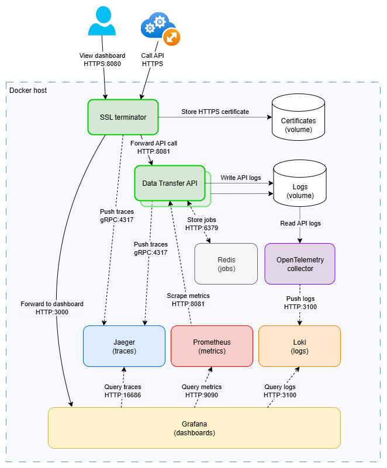

# Architecture

This page explains how the EOSC Data Transfer API is put together and why it behaves the way it
does. It is written for developers who need to change the service or integrate with it, not as a
replacement for the [endpoint reference](../reference/endpoints.md).

## Responsibilities

The service is a stateless Quarkus REST application that fronts three kinds of back ends:

- **Data repositories** are queried by DOI/PID parsers to turn an identifier into a file list.
- **Transfer engines** accept file lists and move the data; the only implementation today is the
  EGI Data Transfer Service (FTS).
- **Storage systems** provide browsing and management of files and folders; the implementations
  cover WebDAV (dCache, StoRM) and S3 (Min.IO).

None of these mappings are compiled into the application. They are read from
`src/main/resources/application.yml` at startup, so an operator can add a destination, point it at a
different engine, or run several engines of the same type without changing code.

## Request path

A request follows the same path for every endpoint:

1. Quarkus routes the request to a JAX-RS resource: `DigitalObjectIdentifier`,
   `DataTransfer`, `DataStorage`, `DataTransferUser` or `ServiceInfo`.
2. The resource validates its inputs and fails fast with a stable error identifier
   (`destInvalid`, `noFiles`, `noJob`, ...).
3. For transfer and storage operations, `DataTransferBase` resolves the `dest` query parameter to a
   destination configuration, then to the transfer service and (optionally) the storage system that
   handle it.
4. The implementation class is loaded by name with
   `Class.forName(...).getDeclaredConstructor().newInstance()` and initialised with its slice of the
   configuration. Implementations must therefore have a public no-argument constructor and must not
   rely on CDI injection.
5. The implementation calls the back end through a MicroProfile REST Client and returns a Mutiny
   `Uni`. Nothing blocks the event loop.
6. The resource serialises the result, or wraps the failure in an `Error` envelope.

## Configuration-driven plug-ins

Three interfaces define the extension points:

| Interface | Responsibility | Current implementations |
| --- | --- | --- |
| `ParserService` | Recognise a DOI and list its files | Zenodo, B2SHARE, ESRF, Signposting |
| `TransferService` | Start, find, inspect and cancel transfers | `EgiDataTransfer` (FTS) |
| `StorageService` | Browse and manage files and folders | `MinioStorage`, `WebDavStorage` |

The configuration has three levels:

```text
eosc.transfer.destination.<dest>  ->  service: <serviceId>
                                      storage: <storageId>   (optional)
eosc.transfer.service.<serviceId> ->  class: <TransferService implementation>
eosc.transfer.storage.<storageId> ->  class: <StorageService implementation>
```

This is why the API takes a *destination storage type* instead of a protocol: several destinations
may speak the same protocol but be handled by different engines, and one engine may serve many
destinations. The `dest` values accepted by an instance are exactly the keys configured under
`eosc.transfer.destination`; `GET /storage/destinations` reports them with the engine and storage
service that handle each one.

## Authorization model

The service does not validate or interpret access tokens. It behaves as a pass-through:

- `Authorization` carries the OIDC access token. Authenticated operations require it; the DOI parser
  forwards it only when the caller supplies it, because most repositories are open access.
- `Authorization-Storage` carries credentials for the storage system itself, Base-64 encoded as
  `user:password` (WebDAV/FTP) or `access-key:secret-key` (S3). It is needed when the storage system
  does not accept the OIDC token.
- HTTP `419` tells the client that the credentials it delegated are no longer usable and must be
  re-delegated. It is not a rate limit and not a synonym for `401`.

Because the token is forwarded unchanged, the caller - not this service - decides which audiences
and scopes are granted.

## Accounting pipeline

Transfers are accounted per user, but the outcome is only known when a job finishes. The pipeline is
therefore asynchronous:

1. When `POST /transfers` succeeds, `DataTransfer` appends the job to the Redis stream
   `transfer:jobs`.
2. `AccountingCollector` starts with the application, joins the stream as consumer group `api` and
   keeps one pending entry per started job.
3. Every `eosc.service.accounting.check-transfer-status` seconds (60 by default) it asks the transfer
   engine for the job status.
4. When the job reaches a terminal state, it builds a `DataTransferUsageRecord` and posts it to the
   GRNET accounting service configured under `eosc.service.accounting`.

If the job cannot be recorded, the transfer still starts; the response then carries a warning in
`description` and the reason in `reason`.

## Observability

The deployment collects all three telemetry signals:

- **Traces** are exported over OTLP to the OpenTelemetry collector, which forwards them to Jaeger.
- **Metrics** are exposed by Micrometer for Prometheus at `/metrics`, with optional quantiles and
  service-level objectives configured under `eosc.qos`.
- **Logs** are written as JSON to `logs/data-transfer.json` and shipped to Loki; the log context
  carries `destination`, `serviceId`, `storageId`, `callerId` and `version` so that requests can be
  filtered across services.

A provisioned Grafana dashboard in `src/main/docker/grafana` visualises the result.

## Deployment topology

The Docker Compose deployment runs the API behind an SSL terminator and adds the supporting
services:



| Container | Role |
| --- | --- |
| `api` | This application |
| `cert` | nginx SSL terminator, also serves telemetry endpoints |
| `redis` | Job store for accounting |
| `otelcol` | OpenTelemetry collector |
| `jaeger` | Trace storage and UI |
| `loki` | Log storage |
| `prometheus` | Metric storage and alerting |
| `grafana` | Dashboards |

The application listens on port `8089` by default; the SSL terminator publishes the public port
configured in `src/main/docker/.env`.

## Failure handling

Every failure is reported through the same envelope: the HTTP status carries the outcome and `id`
is a stable lowerCamelCase key. The mapping is intentionally simple:

- input validation and unsupported values produce `400` and a specific identifier;
- missing or forbidden credentials produce `401` or `403`, and re-delegation produces `419`;
- missing configuration, engine timeouts and unexpected engine errors produce `500`;
- when a back end answers with an error status, that status is passed through together with the
  engine's explanation.

See the [error reference](../reference/error-ids.md) for the full list.

